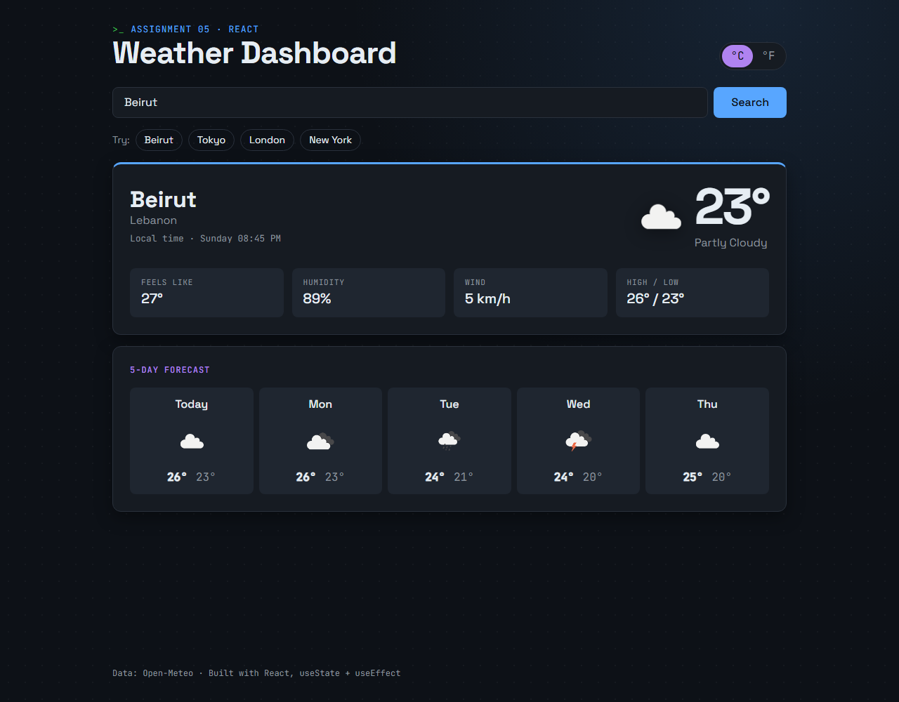
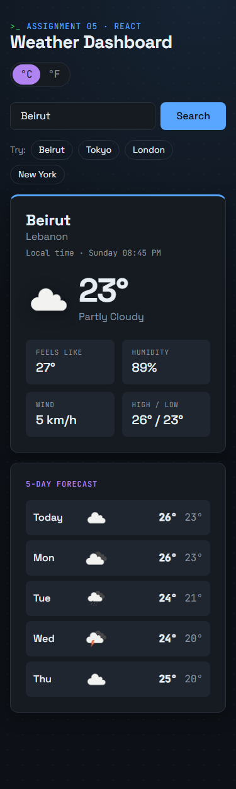
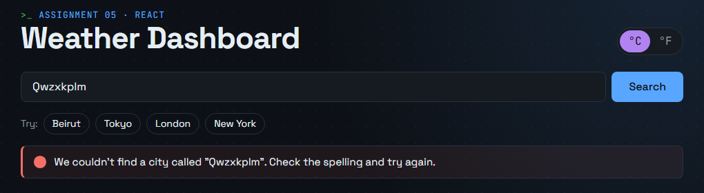

# Weather Dashboard (React): Assignment 5

My Assignment 4 Weather Dashboard, rebuilt as a React app with Vite. It's split into small components, keeps its data in `useState`, and fetches with `useEffect`.

Type a city (or pick one) to see the current temperature, conditions, feels-like, humidity, wind, today's high/low and a 5-day forecast. Switch between °C and °F at any time.





## Install and run

You need **Node.js 20 or later** (`node -v`).

```bash
git clone https://github.com/Harb250/weather-react.git
cd weather-react
npm install
npm run dev
```

Open the URL Vite prints (usually <http://localhost:5173>). Opening `index.html` directly, or with VS Code's Live Server, won't work: the JSX has to go through Vite.

No API key is needed. Weather data comes from [Open-Meteo](https://open-meteo.com/), which is free and keyless, so the app works straight after `npm install`.

Other scripts: `npm run build` (production build in `dist/`) and `npm run preview` (serve that build).

## Features

- Search by city: press Enter or click **Search**. There are also quick-pick buttons.
- **Form validation:** an empty search, a search with no letters or one over 80 characters shows a message under the field and doesn't fetch. The message clears as soon as you type.
- **Loading, error and success states:**
  - Loading: a spinner and message. The Search button and quick picks are disabled, and the old result fades out.
  - Error: a plain-language message, with a **Retry** button when retrying could help (offline, timeout, server error).
  - Success: a current-weather card and the 5-day forecast.
- °C / °F toggle, shared through Context.
- The browser tab title shows the live temperature, e.g. `23°C · Beirut`.
- Remembers the last city you searched (localStorage), and opens a city from the URL: `/?city=Tokyo`.
- Responsive from 320px phones to desktop (CSS Grid + Flexbox).

## Project structure

```
src/
├── main.jsx                  # mounts <App /> in StrictMode
├── App.jsx                   # owns the state, runs the effects, lays out the page
├── index.css                 # design tokens + component styles
├── api/
│   ├── getJSON.js            # fetch + 10s timeout + res.ok check → ApiError
│   └── openMeteo.js          # geocode city → fetch forecast → map to our own shape
├── context/
│   └── UnitsContext.js       # °C/°F context, useUnits() hook, formatTemp()
└── components/
    ├── Header.jsx            # title + UnitToggle
    ├── UnitToggle.jsx        # °C / °F buttons (reads/writes context)
    ├── SearchBar.jsx         # controlled form with validation
    ├── Suggestions.jsx       # quick-pick city buttons
    ├── LoadingSpinner.jsx    # loading state
    ├── ErrorMessage.jsx      # error state + Retry
    ├── WeatherCard.jsx       # current conditions
    ├── Stat.jsx              # one label/value tile inside WeatherCard
    ├── Card.jsx              # layout wrapper that takes children
    ├── Forecast.jsx          # list of days, inside a Card
    ├── ForecastDay.jsx       # one day (keyed by date)
    └── WeatherIcon.jsx       # weather icon image
```

Every component is a function component in its own file. There are no class components.

## Component tree and data flow

```
App                        state: query, city, attempt, weather, status, error, unit
├── UnitsContext.Provider  value: { unit, setUnit }
├── Header
│   └── UnitToggle         ← context (unit, setUnit)
├── SearchBar              ← query, onQueryChange, onSearch, disabled   → calls onSearch(city)
├── Suggestions            ← cities, onPick, disabled                  → calls onPick(city)
├── LoadingSpinner         ← city                (status === 'loading')
├── ErrorMessage           ← error, city, onRetry (status === 'error')
├── WeatherCard            ← place, current, today
│   ├── WeatherIcon        ← code, alt
│   └── Stat ×4            ← label, value
└── Forecast               ← days
    └── Card               ← title, children
        └── ForecastDay    ← day, isToday (key = date)
            └── WeatherIcon
```

Data goes down as props, and events come back up through callbacks (`onSearch`, `onPick`, `onQueryChange`, `onRetry`).

### State (`useState`)

| State | Lives in | Why there |
|---|---|---|
| `query` | `App` | The search box text. Lifted to `App` because **two siblings** change it: `SearchBar` (typing) and `Suggestions` (clicking a city fills the box). |
| `city` | `App` | The city being shown. Changing it triggers the fetch. |
| `attempt` | `App` | A counter. Bumping it re-runs the fetch for Retry, or when you search the same city again. |
| `weather`, `status`, `error` | `App` | The fetch result and which screen to show (`idle` / `loading` / `success` / `error`). |
| `unit` | `App` (shared through Context) | Needed by `UnitToggle`, `WeatherCard` and `ForecastDay`. |
| `error` (validation) | `SearchBar` | Local to the form, so no other component needs it. |

### Effects (`useEffect`)

1. **Fetch weather:** runs when `[city, attempt]` changes. It defines an `async` function inside the effect and calls it (an effect can't be `async` itself). It uses `try`/`catch`, and sets `status` to `loading`, then `success` or `error`. The cleanup aborts the request with an `AbortController`, so a fast second search can't be overwritten by a slower first one. This also handles StrictMode running the effect twice in development.
2. **Remember the last city:** runs when `[status, weather]` changes. It saves the city to `localStorage` after a successful load.
3. **Tab title:** runs when `[status, weather, unit]` changes. It writes the temperature into `document.title`.

### Prop drilling: why it stays within two levels

- Weather data is only ever passed **one or two levels**: `App → Forecast → ForecastDay` and `App → WeatherCard → Stat`.
- The **temperature unit** is needed deep in the tree (`ForecastDay` sits under `Forecast → Card`) and also in `Header → UnitToggle`. Passing it as props would make `Header`, `Forecast` and `Card` carry a prop they never use. Unit choice is app-wide data, like a theme or language, so it goes in **`UnitsContext`**. `UnitToggle`, `WeatherCard` and `ForecastDay` read it with `useUnits()`.
- `Card` uses **composition** (`children`): `Forecast` puts its list inside the card, so `Card` never needs to know about forecast data.

## Error handling

Every request goes through `getJSON()` in `src/api/getJSON.js`:

1. `fetch()` rejects on network failure, or when the 10-second timeout aborts it. Both become an `ApiError`.
2. A `404` or `500` doesn't reject, so the code checks `res.ok` and throws.
3. Invalid JSON is caught too.

`ErrorMessage` turns the error's `kind` into a friendly message:

| Situation | What the user sees | Retry |
|---|---|---|
| Empty / invalid search | Message under the search field | — |
| City not found | "We couldn't find a city called …" | — |
| Offline / DNS | "Couldn't reach the weather service…" | ✓ |
| Slow server (> 10 s) | "…taking too long to answer." | ✓ |
| Rate limited (`429`) | "Too many requests right now…" | ✓ |
| Server error (`5xx`) | "…having problems (HTTP 500)…" | ✓ |



**Try it:** in DevTools → **Network**, set throttling to **Offline** and search. Or search for a nonsense name like `Qwzxkplm`.

## Tech

React 19, Vite 7, function components and hooks (`useState`, `useEffect`, `useContext`), the Fetch API with `AbortController`, and CSS custom properties, Grid and Flexbox.

## Credits

- Weather and geocoding data: [Open-Meteo](https://open-meteo.com/)
- Weather icons: OpenWeatherMap icon set
